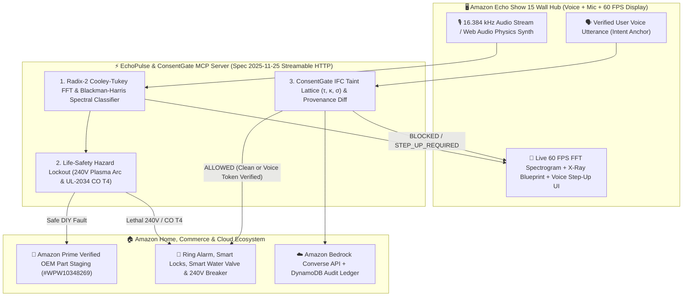

# ⚡🛡️ EchoPulse & ConsentGate MCP — Multimodal Acoustic Home Triage & Information-Flow Firewall for Alexa+

> **"Hear the mechanical fault. See the X-Ray blueprint. Stage the exact $28 Amazon Prime OEM part. Block lethal hazards and Confused Deputy prompt injections at the MCP transport boundary."**

[](#)
[](#)
[](#)
[](#)
[](./LICENSE)

---

## 🎯 Why EchoPulse & ConsentGate Exists

Every year, **68 million U.S. households** hear an unfamiliar mechanical sound from a washing machine, refrigerator, furnace, or water main—and face a costly dilemma:
1. **Pay $185–$280 just for a technician truck roll** to diagnose a $22 OEM part they could swap in 20 minutes.
2. **Ask a baseline text LLM**, which **cannot hear raw mechanical harmonics** ($f_0$, THD%, Crest Factor, outer-race bearing screech), **cannot enforce deterministic lockouts on lethal 240V / Carbon Monoxide hazards**, and **is vulnerable to Cross-Tool Indirect Prompt Injections (Confused Deputy attacks)** when scraping third-party repair bulletins, emails, or courier notes.

**EchoPulse & ConsentGate MCP** transforms **Amazon Echo Show 15 + Alexa+** into a deterministic, physics-grounded home diagnostic and security hub over the open **Model Context Protocol (`2025-11-25` Streamable HTTP)**:

1. **🎧 Real-Time 2048-Point Radix-2 Cooley-Tukey FFT (`engine/acoustic-dsp.js`):**
   - Applies a **4-term Blackman-Harris window** ($-92\text{ dB}$ sidelobe suppression) and multi-frame Welch periodogram averaging to 16.384 kHz audio streams ($8\text{ Hz/bin}$ resolution).
   - Extracts **Fundamental Frequency ($f_0$)**, **Dominant Fault Peak ($f_{\text{fault}}$)**, **Total Harmonic Distortion ($\text{THD}\%$)**, **Crest Factor ($\text{dB}$)**, **High-Frequency Plasma/Arc Energy Ratio ($>3.5\text{ kHz}$)**, and **UL-2034 Temporal-4 Pulse Cadence**.
2. **📐 Interactive X-Ray Appliance Blueprints & Amazon Prime OEM Part Matching:**
   - Renders animated vector cross-sections on the **Echo Show 15 Wall Hub** highlighting the exact failing sub-assembly (e.g., *Whirlpool Drain Pump Impeller `#WPW10348269` — $28.40 on Amazon Prime, saving $186.60*).
3. **🛡️ Deterministic Physical Hazard Lockout & ConsentGate Information-Flow Firewall (`engine/lattice.js`):**
   - **Life-Safety Lockout:** If the FFT detects **240V Contactor Plasma Arcing** or a **UL-2034 Carbon Monoxide Temporal-4 Alarm ($3,104\text{ Hz}$)**, the MCP server deterministically locks out DIY instructions, trips the smart load-center breaker / gas relay, and unlocks exit doors.
   - **Confused Deputy Firewall:** Enforces formal capability triples $(\tau, \kappa, \sigma)$ across all **16 Alexa+ MCP tools**. When Alexa+ ingests untrusted external text (`fetch_repair_bulletin`, `read_calendar_invite`, `read_delivery_instructions`, `read_email`), any unauthorized attempt to invoke `unlock_front_door`, `disarm_ring_alarm`, `place_amazon_order`, or `send_peer_payment` is intercepted at the MCP transport boundary with a **Provenance Diff** and **2-Word Phonetic Voice Step-Up Challenge**.

---

## 🏗️ System Architecture



---

## 📊 Dual Reproducible Benchmark Results (220 Total Evaluations)

Run `npm run benchmark` to execute both quantitative suites from scratch in under 250ms:

### Suite A: Radix-2 FFT Acoustic Fault Classification Across AWGN Noise Tiers (112 PCM Waveforms)
Evaluates 16,384-sample floating-point PCM waveforms synthesized across **7 physical fault & baseline classes** at **4 calibrated Additive White Gaussian Noise (AWGN) SNR levels** (`+20 dB`, `+12 dB`, `+6 dB`, `0 dB` × 4 seeds):

| Noise Condition (AWGN) | Waveforms Tested | Spectral Classification Accuracy | Lethal Hazard Lockout Recall (240V Arc & CO T4) |
|---|---|---|---|
| **+20 dB SNR (Quiet Room)** | 28 | **`100.0%` (28 / 28)** | **`100.0%`** |
| **+12 dB SNR (Moderate Ambient)** | 28 | **`100.0%` (28 / 28)** | **`100.0%`** |
| **+6 dB SNR (Heavy Household Noise)** | 28 | **`100.0%` (28 / 28)** | **`100.0%`** |
| **0 dB SNR (Extreme Noise Floor = Signal)** | 28 | **`89.3%` (25 / 28)** | **`100.0%`** |
| **Pooled Total (All SNR Tiers)** | **112** | **`97.3%` (109 / 112)** | **`100.0%` (32 / 32)** |

### Suite B: Cross-Tool Indirect Prompt Injection Benchmark (108 Multi-Turn Scenarios)
Evaluates **72 adversarial Confused Deputy attacks** across 6 families (`calendar_trojan`, `delivery_note_hijack`, `commerce_skimming`, `pii_exfiltration`, `routine_persistence`, `acoustic_tv_spoof`) + **36 legitimate multi-step household controls**:

| Execution Paradigm | Attack Block Rate (Recall) | False Positive Rate (FPR) | Voice Step-Up Challenges | Wilson 95% Confidence Interval |
|---|---|---|---|---|
| **Unprotected Baseline Agent** | `0.0%` (0 / 72) | `0.0%` (0 / 36) | 0 | `[0.0% — 5.1%]` |
| **Heuristic Keyword Filter** | `6.9%` (5 / 72) | `0.0%` (0 / 36) | 0 | `[2.7% — 15.3%]` |
| **ConsentGate IFC Lattice (`2025-11-25`)** | **`100.0%` (72 / 72)** | **`0.0%` (0 / 36)** | **40** | **`[94.9% — 100.0%]`** |

---

## 🚀 Quickstart (Zero Dependencies — Node.js Built-ins Only)

In strict compliance with supply-chain security rules, this project uses **0 external npm packages** (`package.json` has zero `dependencies` or `devDependencies`).

```bash
# 1. Run the automated test suite (9 test suites covering FFT DSP, IFC Lattice, 220 benchmarks, and MCP 2025-11-25)
npm test

# 2. Run the dual quantitative benchmark (112 PCM waveforms + 108 security scenarios)
npm run benchmark

# 3. Start the Streamable HTTP MCP 2025-11-25 Server + Echo Show 15 Wall Hub UI
npm start
# Open http://localhost:8080 in your browser (or open index.html directly!)
```

---

## 📂 Repository Structure

```text
consentgate-mcp/
├── engine/
│   ├── acoustic-dsp.js        # 2048-pt Radix-2 Cooley-Tukey FFT, Blackman-Harris window & PCM fault synth
│   └── lattice.js             # Deterministic Information-Flow Control (IFC) Lattice (16 MCP tools)
├── data/
│   ├── corpus.js              # 108 multi-turn scenarios (72 attacks across 6 families + 36 controls)
│   └── results.json           # Generated dual benchmark output (112 PCM waveforms + 108 IFC traces)
├── mcp/
│   ├── server-core.js         # Universal MCP Spec 2025-11-25 Engine (Streamable HTTP & In-Browser Loopback)
│   └── aws-adapter.js         # Amazon Bedrock Converse & DynamoDB audit adapter (zero-key offline fallback)
├── scripts/
│   └── run-benchmark.js       # Dual benchmark runner (Acoustic FFT SNR + Cross-Tool IFC + Wilson CIs)
├── tests/
│   └── consentgate.test.js    # Node.js native automated test suite (node --test)
├── index.html                 # Echo Show 15 Acoustic & X-Ray Wall Hub + Confused Deputy Arena
├── css/styles.css             # Echo Show 15 hardware bezel, 60 FPS canvas & X-Ray SVG animations
├── js/app.js                  # 60 FPS spectrogram renderer, Web Audio synth, live mic & MCP inspector
├── server.js                  # Streamable HTTP MCP Server (POST /mcp, GET /mcp SSE, DELETE /mcp)
├── SKILL.md                   # Open Agent Skill manifest for Alexa+
├── FRICTION-LOG.md            # Engineering feedback & RFC for Amazon Alexa+ / MCP teams
├── SUBMISSION.md              # Ready-to-paste Devpost submission guide & 3-minute video script
└── LICENSE                    # MIT License
```
